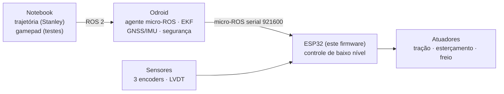
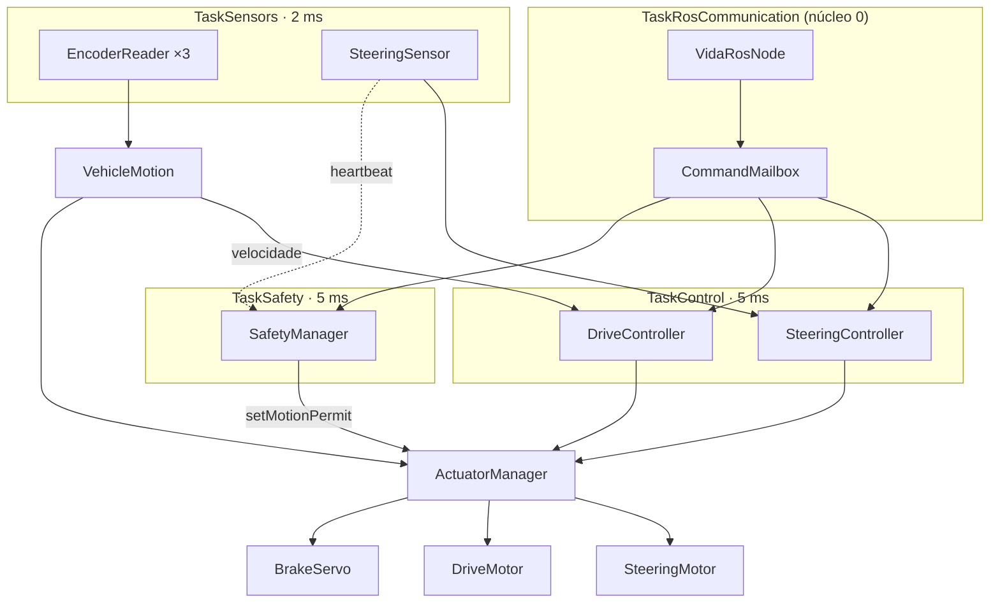

# Documentação do firmware ESP32 — Projeto VIDA

Documentação técnica do firmware do ESP32 do **VIDA (Veículo Inteligente de Desenvolvimento Aplicado)**, do Laboratório de Mobilidade Terrestre (LMT) da UFLA.

O ESP32 é a camada de **controle de baixo nível** do veículo: lê os sensores, controla os atuadores, garante a segurança e troca dados com o ROS 2 via micro-ROS (serial).

## Como esta documentação está organizada

A pasta `doc/` segue a mesma estrutura de `include/` e `src/`: uma página por classe.

| Módulo | Classe | Responsabilidade |
|---|---|---|
| — | [main.cpp](main.md) | Instâncias, tasks FreeRTOS e inicialização |
| **sensors** | [EncoderReader](sensors/EncoderReader.md) | Encoder em quadratura: contagem, velocidade e aceleração |
| | [SteeringSensor](sensors/SteeringSensor.md) | LVDT: ângulo de esterçamento e validação da leitura |
| | [VehicleMotion](sensors/VehicleMotion.md) | Velocidade do veículo, veículo parado e velocidade para inversão |
| **control** | [SteeringController](control/SteeringController.md) | Controle de posição do esterçamento (PI) |
| | [DriveController](control/DriveController.md) | Controle longitudinal de velocidade (tração e freio) |
| **actuators** | [ActuatorManager](actuators/ActuatorManager.md) | Acesso único aos atuadores, permissão e intertravamento |
| | [DriveMotor](actuators/DriveMotor.md) | Motor de tração: PWM + DIR, inversão só parado |
| | [SteeringMotor](actuators/SteeringMotor.md) | Motor de esterçamento: dois PWMs com tempo morto |
| | [BrakeServo](actuators/BrakeServo.md) | Servo do freio: rampa de falha e alívio parado |
| | [MotorHardware](actuators/MotorHardware.md) | Abstração do hardware de saída (injeção em testes) |
| **safety** | [SafetyManager](safety/SafetyManager.md) | Permissão de movimento e motivos de bloqueio |
| | [SafetyWatchdogs](safety/SafetyWatchdogs.md) | Avaliação dos watchdogs de tempo |
| | [EncoderPlausibility](safety/EncoderPlausibility.md) | Roda traseira × dianteiras (encoder sem sinal, bancada) |
| **comunication** | [CommandMailbox](comunication/CommandMailbox.md) | Últimas referências recebidas do ROS |
| | [RosCommunication](comunication/RosCommunication.md) | Sessão micro-ROS, reconexão e sincronização de relógio |
| | [VidaRosNode](comunication/VidaRosNode.md) | Tópicos ROS do firmware |
| **utils** | [config.h](utils/config.md) | Todos os parâmetros, por módulo |
| | [pinout.h](utils/pinout.md) | Pinagem do ESP32 |
| | [utils.h](utils/utils.md) | Funções auxiliares |

Diagramas em PDF (arquitetura, tasks, segurança e controle de esterçamento) ficam em [`arquitetura/`](arquitetura/).

## Visão geral do fluxo de dados

## Convenções usadas em todo o firmware

| Assunto | Convenção |
|---|---|
| Ângulo de esterçamento | Graus, ângulo da roda virtual do modelo de bicicleta, **REP-103: esquerda positivo** (`STEERING_INVERT_SIGN = 1`) |
| Comandos de motor | Normalizados em `[-1, 1]`, convertidos para duty de 8 bits (0–255) |
| Freio | `0` = solto, `1` = freio total |
| Velocidade | m/s; positiva no sentido de contagem positivo do encoder. Velocidade do veículo = média das rodas dianteiras |
| Tempo interno | `esp_timer_get_time()` em µs desde o boot (`*_us`) |
| Tempo publicado no ROS | Relógio do agente (Odroid), após a sincronização |
| Idade de um dado | `agora − instante da amostra/chegada`; os watchdogs comparam essa idade com um limite |
| Snapshot | Cópia coerente dos dados de um objeto, lida sob `portMUX`/mutex |
| Comentários no código | Português sem acentos; documentação em português com acentos |

## Princípios de projeto

- **Tasks enxutas:** as tasks do [`main.cpp`](main.md) só chamam métodos e repassam snapshots por parâmetro; a lógica fica nas classes.
- **Falha segura:** dado inválido ou velho nunca vira comando. Sem permissão, os motores param e o freio vai a total em rampa.
- **Dados com idade:** toda medição e referência carrega o instante em que foi produzida ou recebida.
- **Hardware injetável:** os atuadores recebem [`MotorHardware`](actuators/MotorHardware.md), o que permite testá-los sem o ESP32.
