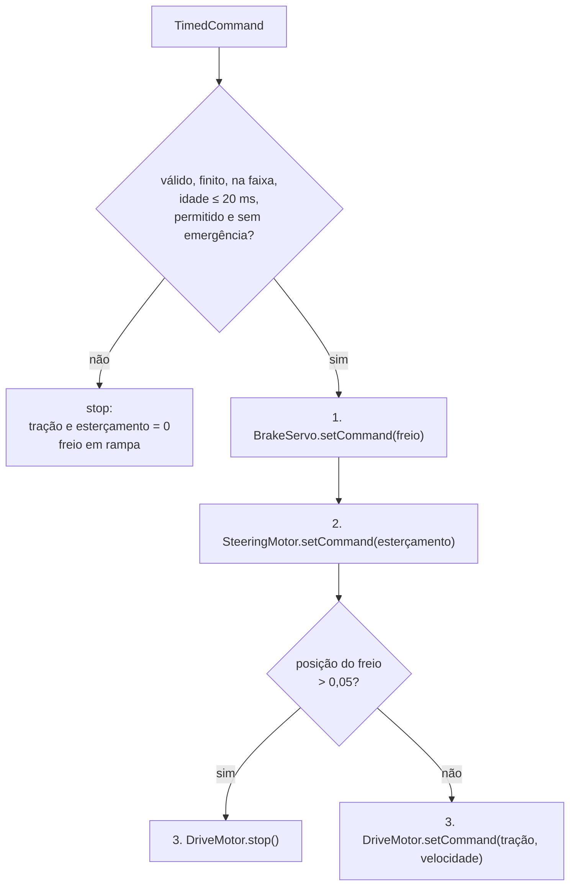

# ActuatorManager

> `include/actuators/ActuatorManager.h` · `src/actuators/ActuatorManager.cpp`

## Visão geral

**Ponto único de acesso** aos três atuadores: [DriveMotor](DriveMotor.md), [SteeringMotor](SteeringMotor.md) e [BrakeServo](BrakeServo.md). Garante que:

- os comandos só são aplicados com **permissão de movimento** (dada pelo [SafetyManager](../safety/SafetyManager.md)) e com o comando **válido e recente**;
- em qualquer outro caso, tração e esterçamento param e o freio vai a total em **rampa**;
- com o freio acionado, a tração é zerada (**intertravamento**).

## Onde é usada

| Quem | Método | Frequência |
|---|---|---|
| `TaskControl` | `applyCommands()`, `isMotionPermitted()` | 200 Hz |
| `TaskSafety` | `updateBrake()` | 200 Hz |
| [SafetyManager](../safety/SafetyManager.md) | `setMotionPermit()` | nas transições de estado |
| [VidaRosNode](../comunication/VidaRosNode.md) | `getSnapshot()` | 50 Hz |

## Interface pública

| Método | Descrição |
|---|---|
| `ActuatorManager(drive, steering, brake)` | Referências aos atuadores |
| `begin()` | Cria o mutex e parte com movimento bloqueado e atuadores parados |
| `applyCommands(command, drive_velocity)` | Aplica um `TimedCommand` (ver abaixo); `true` se aplicado |
| `setMotionPermit(permitted)` | Libera ou bloqueia o movimento; bloquear para tudo na hora |
| `updateBrake(vehicle_stopped)` | Avança a rampa de falha e o alívio do freio parado |
| `stop()` | Para os motores e inicia a rampa do freio, sem mudar a permissão |
| `emergencyStop()` | Como `stop()`, mas retém a emergência até um novo `begin()` (sem chamador hoje) |
| `isMotionPermitted()`, `isEmergencyLatched()` | Estado atual |
| `getSnapshot()` | Estado coerente dos três atuadores, para telemetria |

### TimedCommand

| Campo | Faixa | Descrição |
|---|---|---|
| `drive_command` | [-1, 1] | Tração |
| `steering_command` | [-1, 1] | Esterçamento na **convenção do motor** (`> 0` = direita) |
| `brake_command` | [0, 1] | Freio |
| `produced_at_us` | µs | Instante de criação do comando |
| `valid` | — | Saídas dos controladores válidas |

## Funcionamento de `applyCommands()`

A idade máxima do comando é `CONTROL_OUTPUT_WATCHDOG_TIMEOUT_MS` (20 ms). `drive_velocity` vem do [VehicleMotion](../sensors/VehicleMotion.md) e autoriza a troca de sentido no [DriveMotor](DriveMotor.md).

## Parâmetros (`config.h`)

| Parâmetro | Valor | Uso |
|---|---|---|
| `CONTROL_OUTPUT_WATCHDOG_TIMEOUT_MS` | 20 ms | Idade máxima do comando |
| `BRAKE_DRIVE_CUTOFF` | 0,05 | Posição do freio que corta a tração |

## Concorrência

Todas as operações tomam um **mutex FreeRTOS** (`xSemaphoreTake` com espera indefinida), porque são chamadas por `TaskControl`, `TaskSafety` e `TaskRosCommunication`. Se o mutex não existir (antes de `begin()`), os métodos de parada agem direto nos atuadores e os demais retornam sem efeito.

## Pontos de atenção

- O mutex usa espera indefinida: uma task travada com o mutex bloquearia as outras. Hoje nenhuma operação dentro do mutex é bloqueante.
- `emergencyStop()` não é chamado em lugar nenhum; fica disponível para uma futura parada de emergência por software.
