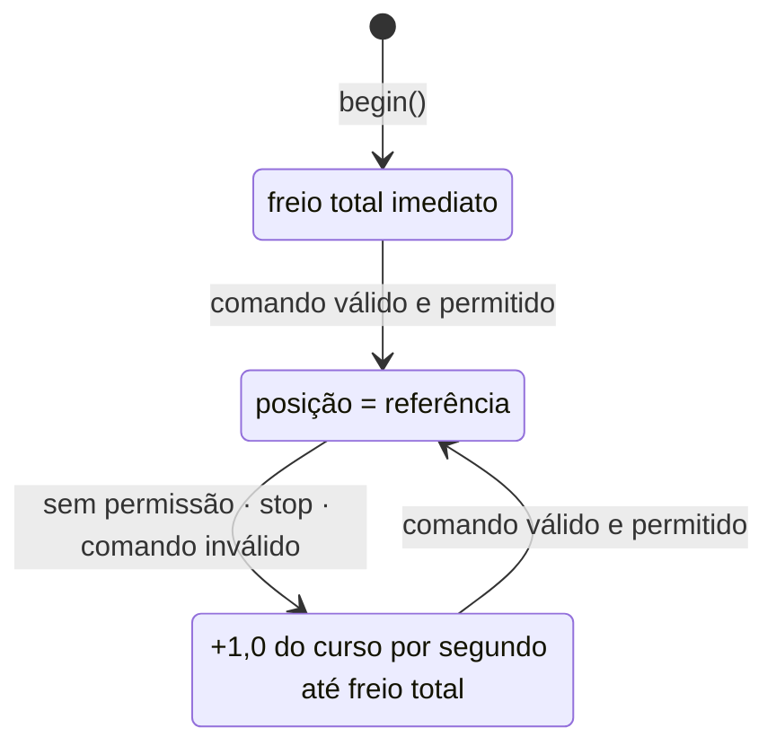

# BrakeServo

> `include/actuators/BrakeServo.h` · `src/actuators/BrakeServo.cpp`

## Visão geral

Servo de hobby (50 Hz, GPIO 4) que puxa o **cabo de aço do freio a disco** da roda traseira. É usado tanto para reduzir a velocidade (referência do ROS) quanto como **freio de segurança**.

Posição normalizada: `0` = solto, `1` = freio total, convertida linearmente em largura de pulso:

```
pulso = BRAKE_RELEASED_US + posição × (BRAKE_APPLIED_US − BRAKE_RELEASED_US)
        2500 µs (solto) → 1500 µs (freio total)
```

## Onde é usada

| Quem | Método | Frequência |
|---|---|---|
| `setup()` | `begin()` | primeira inicialização do firmware |
| [ActuatorManager](ActuatorManager.md) (`TaskControl`) | `setCommand()`, `applyFaultRamp()` | 200 Hz |
| [ActuatorManager](ActuatorManager.md) (`TaskSafety`) | `update(vehicle_stopped)` | 200 Hz |

## Interface pública

| Método | Descrição |
|---|---|
| `BrakeServo(pin, channel, hardware = nullptr)` | `hardware` opcional (testes) |
| `begin()` | Freio total imediato (o veículo está parado no boot) |
| `setCommand(position)` | Operação normal: a posição segue o comando **sem rampa**. Comando inválido ou fora de [0, 1] inicia a rampa de falha |
| `applyFaultRamp()` | Inicia a rampa até freio total (chamadas repetidas mantêm a rampa) |
| `update(vehicle_stopped)` | Avança a rampa e atualiza o alívio com o veículo parado |
| `getPosition()` | Posição comandada |
| `getSnapshot()` | Posição, pulso, rampa ativa, alívio ativo e instante |

## Modos



**Alívio com o veículo parado** (vale em qualquer modo): com o [VehicleMotion](../sensors/VehicleMotion.md) indicando parado continuamente por `BRAKE_HOLD_CONFIRMATION_MS` (1 s), o **pulso** é limitado a `BRAKE_HOLD_US` (1600 µs, 90% do curso) para não forçar o servo segurando o freio. A posição comandada não muda; qualquer movimento volta imediatamente ao pulso total.

A rampa de falha só avança em `update()`, chamado pela `TaskSafety`. Assim, ela não depende de a `TaskControl` estar funcionando.

## Parâmetros (`config.h`)

| Parâmetro | Valor | Uso |
|---|---|---|
| `BRAKE_SERVO_FREQUENCY_HZ` / `BRAKE_SERVO_RESOLUTION_BITS` | 50 Hz / 16 bits | PWM do servo (canal LEDC 4, timer próprio) |
| `BRAKE_CALIBRATED` | 1 | `0` = nenhum pulso é enviado (freio inoperante) |
| `BRAKE_RELEASED_US` / `BRAKE_APPLIED_US` | 2500 / 1500 µs | Freio solto / total (30/10: 1600 -> 1500, em passos) |
| `BRAKE_HOLD_US` | 1600 µs | Pulso máximo com o veículo parado |
| `BRAKE_HOLD_CONFIRMATION_MS` | 1000 ms | Tempo parado antes do alívio |
| `BRAKE_FAULT_RATE_PER_S` | 1,0 /s | Velocidade da rampa de falha |
| `BRAKE_DRIVE_CUTOFF` | 0,05 | Acima disto o [ActuatorManager](ActuatorManager.md) zera a tração |

Asserções em tempo de compilação garantem pulsos entre 500 e 2500 µs e `BRAKE_HOLD_US` entre solto e total.

## Concorrência

Chamada apenas sob o mutex do [ActuatorManager](ActuatorManager.md). O snapshot é protegido por `portMUX`.

## Pontos de atenção

- **Sem pulsos o servo fica solto** e o freio é liberado. A classe não cobre reset do ESP32 nem falta de alimentação do servo. Por isso `begin()` é a primeira chamada do `setup()`.
- A rampa de falha leva até 1 s para chegar ao freio total a partir do freio solto.
