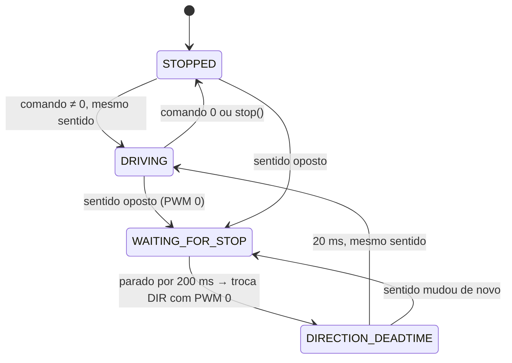

# DriveMotor

> `include/actuators/DriveMotor.h` · `src/actuators/DriveMotor.cpp`

## Visão geral

Motor de **tração** (DC 36 V, 1000 W) acionado por um driver de potência com:

- **1 PWM** de velocidade (GPIO 27, 9 kHz, 8 bits);
- **1 pino de direção** (DIR, GPIO 14): `HIGH` = ré.

Regra principal: **o sentido só muda com o veículo 100% parado**. Ao pedir o sentido oposto, o PWM é zerado na hora, mas o pino DIR só troca depois de a velocidade medida ficar abaixo do limiar por um tempo contínuo.

> A ré ainda **não funciona no hardware**: falta instalar o circuito de relés em ponte H na saída do driver. A lógica de inversão já está pronta.

## Onde é usada

| Quem | Método |
|---|---|
| [ActuatorManager](ActuatorManager.md) | `setCommand()`, `stop()`, `getSnapshot()` |

## Interface pública

| Método | Descrição |
|---|---|
| `DriveMotor(pwm_pin, direction_pin, pwm_channel, hardware = nullptr)` | `hardware` opcional (testes) |
| `begin()` | Configura DIR em "frente" **antes** do PWM e parte parado |
| `setCommand(command, velocity)` | Comando `[-1, 1]` (`> 0` frente, `< 0` ré, `0` para) e velocidade para autorizar a inversão |
| `stop()` | Zera o PWM; **nunca** altera DIR |
| `getLastCommand()`, `getLastPwm()`, `isReverse()`, `getState()`, `getSnapshot()` | Estado atual |

### Snapshot

| Campo | Descrição |
|---|---|
| `pwm` | Duty aplicado (0–255) |
| `reverse` | Nível atual do pino DIR |
| `timestamp_us` | Instante da última escrita |
| `state` | Estado da máquina abaixo |
| `direction_change_pending` | `true` em `WAITING_FOR_STOP` |

## Máquina de estados

Condição de "parado" em `WAITING_FOR_STOP`: a medição recebida precisa ser válida, ter idade ≤ `DRIVE_VELOCITY_MEASUREMENT_TIMEOUT_MS` e \|v\| ≤ `DRIVE_STOP_SPEED_THRESHOLD_MPS`, **continuamente** por `DRIVE_STOP_CONFIRMATION_TIME_MS`. Qualquer amostra fora disso reinicia a contagem. A medição vem do [VehicleMotion](../sensors/VehicleMotion.md) e representa o pior caso dos três encoders.

## Parâmetros (`config.h`)

| Parâmetro | Valor | Uso |
|---|---|---|
| `PWM_FREQUENCY_HZ` / `PWM_RESOLUTION_BITS` | 9 kHz / 8 bits | PWM |
| `DRIVE_STOP_SPEED_THRESHOLD_MPS` | 0,05 m/s | Limiar de parado |
| `DRIVE_STOP_CONFIRMATION_TIME_MS` | 200 ms | Tempo contínuo parado antes de trocar DIR |
| `DRIVE_VELOCITY_MEASUREMENT_TIMEOUT_MS` | 50 ms | Idade máxima da medição |
| `DRIVE_DIRECTION_DEADTIME_MS` | 20 ms | Sem torque após trocar DIR |

## Concorrência

Chamada apenas sob o mutex do [ActuatorManager](ActuatorManager.md). O snapshot é protegido por `portMUX`.

## Pontos de atenção (para quando os relés forem instalados)

- 20 ms de tempo morto é pouco para relés; revisar conforme o datasheet (tipicamente 100–200 ms).
- O GPIO 14 emite sinal PWM durante o boot do ESP32, antes de ser configurado, e pode fazer os relés baterem.
- Não há confirmação de que os relés comutaram.
