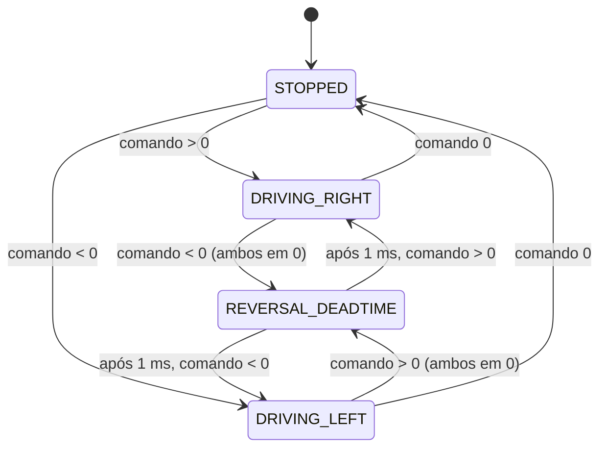

# SteeringMotor

> `include/actuators/SteeringMotor.h` · `src/actuators/SteeringMotor.cpp`

## Visão geral

Motor de **esterçamento** (DC 24 V) acionado por uma ponte H com **dois PWMs independentes**:

| Canal | Pino | Função |
|---|---|---|
| `PWM_CH_STEER_RIGHT` (1) | GPIO 25 | Gira para a direita |
| `PWM_CH_STEER_LEFT` (2) | GPIO 26 | Gira para a esquerda |

Os dois PWMs **nunca ficam ativos ao mesmo tempo**. Ao inverter o sentido, o motor passa por um intervalo com ambos em zero.

Esta classe trabalha no **sentido físico do motor**. A conversão a partir da convenção do ângulo (REP-103) é feita pelo [SteeringController](../control/SteeringController.md), no campo `motor_command`.

## Onde é usada

| Quem | Método |
|---|---|
| [ActuatorManager](ActuatorManager.md) | `setCommand()`, `stop()`, `getSnapshot()` |

## Interface pública

| Método | Descrição |
|---|---|
| `SteeringMotor(right_pin, left_pin, right_ch, left_ch, hardware = nullptr)` | `hardware` opcional (testes) |
| `begin()` | Configura os dois canais e parte parado |
| `setCommand(command)` | `[-1, 1]`: `> 0` direita, `< 0` esquerda, `0` para; não finito para |
| `stop()` | Zera os dois PWMs imediatamente |
| `getLastCommand()`, `getRightPwm()`, `getLeftPwm()`, `getState()`, `getSnapshot()` | Estado atual |

## Máquina de estados

Ao aplicar um sentido, o canal inativo é zerado **antes** da escrita no canal ativo. Como o `setCommand()` é chamado a cada 5 ms, o tempo morto efetivo é de um ciclo de controle.

## Parâmetros (`config.h`)

| Parâmetro | Valor | Uso |
|---|---|---|
| `PWM_FREQUENCY_HZ` / `PWM_RESOLUTION_BITS` | 9 kHz / 8 bits | PWM |
| `STEERING_DIRECTION_DEADTIME_US` | 1000 µs | Tempo mínimo com os dois em zero na inversão |

## Concorrência

Chamada apenas sob o mutex do [ActuatorManager](ActuatorManager.md). O snapshot é protegido por `portMUX`.
