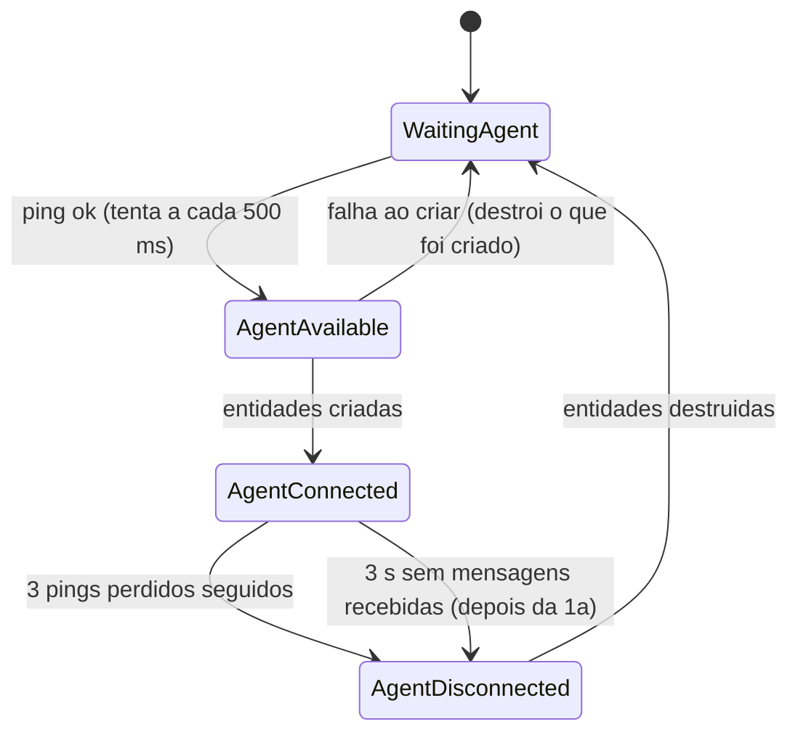

# RosCommunication

> `include/comunication/RosCommunication.h` · `src/comunication/RosCommunication.cpp`

## Visão geral

Infraestrutura **micro-ROS genérica** (não conhece os tópicos do VIDA). Cuida de:

- sessão com o **agente micro-ROS** no Odroid, via serial (921600 baud);
- criação e destruição das entidades: nó, publishers, subscriptions, timers e executor;
- **reconexão automática** se o agente cair;
- **sincronização de relógio** com o host do agente.

Os tópicos do firmware são definidos pelo [VidaRosNode](VidaRosNode.md), que usa esta classe.

## Interface pública

| Método | Descrição |
|---|---|
| `RosCommunication(node_name, namespace, domain_id)` | Identidade do nó |
| `begin(transport)` | Define o transporte serial do micro-ROS |
| `startTask(name, stack, priority, core)` | Cria a task que executa a máquina de estados |
| `addPublisher(...)`, `addSubscription(...)`, `addTimer(...)` | Registram entidades (até 8 de cada), **antes** da primeira conexão |
| `publish(publisher, message)` | Publica se conectado |
| `getState()`, `isConnected()` | Estado da sessão |
| `isTimeSynchronized()` | Relógio sincronizado com o agente |
| `localTimeToEpochNanos(local_us, epoch_ns)` | Converte um instante local para o relógio do agente |

## Máquina de estados



### Laço conectado (a cada 1 ms)

Cada volta faz **no máximo uma** chamada bloqueante e depois roda o executor:

| Ação | Período | Timeout |
|---|---|---|
| Sincronização de relógio (`rmw_uros_sync_session`) | 30 s; **1 s** enquanto não sincronizado | 100 ms |
| Ping do agente (se não houve sincronização nessa volta) | 200 ms | 50 ms |
| `rclc_executor_spin_some` (callbacks de subscriptions e timers) | toda volta | 1 ms |

Os timeouts ficam bem abaixo dos watchdogs de referência (200 ms). Enquanto a task está bloqueada, o executor não recebe mensagens. Uma falha isolada de ping não derruba a sessão.

### Vigia de entrada (sessão "zumbi")

O ping só confirma que *um* agente responde, não que a sessão ainda existe. Um agente que reinicia em menos de ~600 ms (os 3 pings) responde normalmente, mas descarta tudo da sessão antiga: o ESP32 continua em `AgentConnected` sem receber nem publicar nada.

Para detectar isso, toda subscription passa por `subscriptionEntry()`, que guarda o instante da última mensagem antes de chamar o callback registrado. Se alguma mensagem já chegou nesta sessão e todas as subscriptions ficam `INBOUND_TIMEOUT_MS` (3 s) sem receber, a sessão vai para `AgentDisconnected` e é recriada.

- Antes da 1ª mensagem da sessão o vigia não age: com o notebook desligado (ninguém publica referências nem enable lógico) não há reconexão em laço.
- Se o notebook cair com a sessão boa, há uma reconexão (~1 s sem publicar) e depois o ESP32 espera quieto.
- Zumbi com o notebook desligado não é detectado aqui; por isso o agente no Odroid também espera 2 s antes de abrir a serial (`docker-compose.yml`), e aí os pings pegam a queda.

### Sincronização de relógio

`localTimeToEpochNanos()` usa o relógio sincronizado (`rmw_uros_epoch_nanos()`) e desconta a idade da amostra:

```
epoch_ns = epoch_agora − (esp_timer_agora − instante_local) × 1000
```

Enquanto o relógio não está sincronizado, a função retorna `false` e o [VidaRosNode](VidaRosNode.md) não publica nada.

## Configuração

| Item | Valor |
|---|---|
| Transporte | Serial (`board_microros_transport = serial` no `platformio.ini`) |
| Distro | ROS 2 Humble |
| Baud rate | `SERIAL_BAUDRATE` = 921600 (o agente precisa usar o mesmo) |
| Task | `TaskRosCommunication`, núcleo 0, prioridade 2, stack 8192 |

## Pontos de atenção

- Com 3 pings perdidos a cada 200 ms, uma queda real do agente leva ~600 ms para ser detectada. A segurança não depende disso: os watchdogs de referência (200 ms) param o veículo antes.
- Sessão zumbi após reinício rápido do agente (bancada 29/10 e campo 30/10): só voltava com reset do ESP32. Corrigido em 31/10 com o vigia de entrada e a espera de 2 s do agente.
- No teste de 12/10/2026 o ESP32 parou de publicar por ~5 s. A versão anterior desta classe derrubava a sessão na primeira falha de ping, o que é a causa provável.
