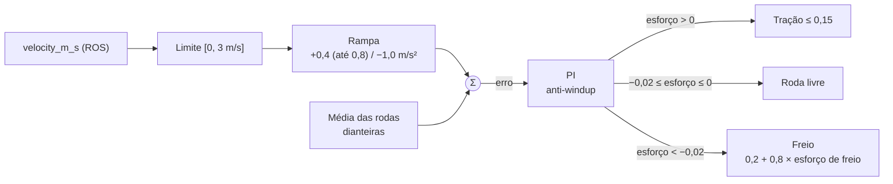

# DriveController

> `include/control/DriveController.h` · `src/control/DriveController.cpp`

## Visão geral

Controle **longitudinal de velocidade** em malha fechada. Recebe a velocidade de referência do ROS (m/s), compara com a velocidade medida do veículo (média das rodas dianteiras) e comanda **tração e freio**.

## Onde é usada

| Quem | Método | Frequência |
|---|---|---|
| `TaskControl` | `update(referência, velocidade do veículo, permissão, modo bancada)` | 200 Hz |

## Interface pública

| Método | Descrição |
|---|---|
| `update(reference, vehicle_speed, motion_permitted, bench_mode)` | Calcula tração e freio de um ciclo; em modo bancada a referência é limitada a 3 m/s, o PI não freia (só corta a tração) e a troca de modo reinicia o controlador |
| `reset()` | Zera a integral; a rampa recomeça na velocidade medida |

### Output

| Campo | Descrição |
|---|---|
| `normalized_command` | Tração `[0, 0,15]` (nunca negativa: sem ré) |
| `brake_command` | Freio `[0, 1]` |
| `valid` | Referência e velocidade válidas e recentes, `dt` na faixa |
| `target_velocity_m_s` | Referência após o limite e a rampa |
| `measured_velocity_m_s` | Velocidade medida |
| `proportional_term`, `integral_term`, `effort` | Parcelas e saída do PI |
| `brake_override` | Freio manual pelo ROS (L2) ativo |
| `holding` | Parado com freio de estacionamento |
| `saturated` | Esforço passou dos limites |

## Funcionamento



Ordem de decisão em cada ciclo:

1. **Validação:** referência não finita ou com mais de 200 ms, velocidade não finita ou com mais de 50 ms, ou `dt` fora de `(0, 100 ms]` → `reset()` e **saída inválida**. O [ActuatorManager](../actuators/ActuatorManager.md) então para tudo e freia em rampa.
2. **Sem permissão de movimento:** integral zerada e rampa igualada à velocidade medida, para retomar sem degrau ao habilitar.
3. **Freio manual** (`brake_command` > 0,05, gatilho L2): referência zerada e **freio total** imediato. Ao soltar, a rampa recomeça na velocidade medida.
4. **Referência:** limitada a `[0, DRIVE_MAX_TARGET_SPEED_M_S]` (negativa vira 0) e passada por uma **rampa**:
   - subida com `acceleration_m_s2` da mensagem (0 = padrão de 0,4 m/s²; teto de 0,8 m/s²). Se o veículo já anda acima da rampa (R2 de novo logo depois de soltar), a subida parte da velocidade medida, sem frear até a rampa;
   - descida a 1,0 m/s².
5. **Parada:** com a rampa ≤ 0,05 m/s, o PI é desligado. **Freio de parada** (1,0 desde 30/10; era 0,6) até o veículo parar e depois **freio de estacionamento** (1,0). O [BrakeServo](../actuators/BrakeServo.md) alivia o pulso após 1 s parado.
6. **PI:** `esforço = Kp·erro + ∫Ki·erro·dt`, com **anti-windup condicional**: a integração que aprofundaria a saturação (tração máxima ou freio total) é rejeitada.
7. **Alocação do esforço:**

   | Esforço | Tração | Freio |
   |---|---|---|
   | > 0 | 0,08 + esforço (PWM 20 a 50) | 0 |
   | entre −0,02 e 0 | 0 | 0 (roda livre) |
   | < −0,02 | 0 | `0,2 + 0,8 × min(1, (−esforço − 0,02) × 3)` |

   A tração começa em 0,08 (PWM 20) para compensar a zona morta da controladora da scooter: girando ela segura com PWM 20 e desarma com 19; parada parte com ~22-23, que a integral alcança em uma fração de segundo. Desacelerando (referência pedida mais de 0,1 m/s abaixo da rampa), o esforço não fica positivo: só roda livre ou freio. Em modo bancada o esforço não fica negativo: acima da referência a roda segue livre, sem freio automático.

   A posição mínima de freio (0,2) compensa a folga do cabo e fica acima de `BRAKE_DRIVE_CUTOFF`: com freio, a tração é sempre cortada.

### Por que a parada é tratada à parte

Perto de zero o erro fica pequeno, o PI freia cada vez menos, e o veículo (com pouco atrito) se arrasta até parar. Em simulação, parar de 1,5 m/s levava 11,6 s só com o PI, contra 2,2 s com o freio de parada.

## Sintonia

Planta identificada no ensaio de 16/08/2026 (PWM aplicado → média das rodas dianteiras):

| Parâmetro | Estimativa |
|---|---|
| Constante de tempo | ~4 s (pouco atrito: com PWM 0 o veículo segue em roda livre) |
| Ganho | ~0,15 (m/s)/PWM ≈ 39 m/s por unidade de comando (~9 m/s² por unidade no início) |
| Atraso | ~0,1–0,2 s |

O modelo tem baixa precisão (gatilho variando muito e perturbações), mas as ordens de grandeza são consistentes.

Ganhos por cancelamento do polo, com constante de tempo em malha fechada de ~1 s (5× o atraso):

```
Kp = τ / (K · Tmf) = 0,10 [comando/(m/s)]      Ki = Kp / τ = 0,025 [comando/m]
```

Simulação com essa planta, os 28 ms do estimador e um freio suposto de 3 m/s²:

| Cenário | Resultado |
|---|---|
| Degrau de 1 m/s | sem sobressinal; 90% em 3,6 s (limitado pela rampa de 0,4 m/s²) |
| Degrau de 3 m/s | sem sobressinal; tração máxima usada 0,11 |
| Descida de 3% | ~11% acima da referência |
| Parada de 1,5 m/s | 2,2 s (4 s com freio fraco de 1 m/s²) |

## Parâmetros (`config.h`)

| Parâmetro | Valor | Uso |
|---|---|---|
| `DRIVE_MAX_TARGET_SPEED_M_S` | 2,5 m/s | Limite da referência (ensaios no chão) |
| `DRIVE_DEFAULT_MAX_ACCEL_M_S2` | 0,4 m/s² | Rampa de subida padrão |
| `DRIVE_MAX_ACCEL_M_S2` | 0,8 m/s² | Teto da rampa de subida |
| `DRIVE_MAX_DECEL_M_S2` | 1,0 m/s² | Rampa de descida |
| `DRIVE_VEL_KP` / `DRIVE_VEL_KI` | 0,10 / 0,025 | Ganhos do PI |
| `DRIVE_BENCH_VEL_KP` / `DRIVE_BENCH_VEL_KI` | 0,008 / 0,008 | Ganhos do PI em modo bancada (roda em vazio) |
| `DRIVE_CONTROL_MAX_DT_S` | 0,1 s | `dt` máximo antes de resetar |
| `DRIVE_MAX_TRACTION_COMMAND` | 0,197 | Tração máxima (PWM 50) |
| `DRIVE_TRACTION_DEADZONE_COMMAND` | 0,08 | Zona morta da controladora (PWM 20): início da tração |
| `DRIVE_DECEL_NO_TRACTION_MARGIN_M_S` | 0,1 m/s | Desacelerando além disso, sem tração |
| `DRIVE_BRAKE_COAST_BAND` | 0,02 | Faixa de roda livre |
| `DRIVE_BRAKE_EFFORT_GAIN` | 3,0 | Escala esforço → freio |
| `DRIVE_BRAKE_ENGAGE_POSITION` | 0,2 | Posição em que o freio começa a agir |
| `DRIVE_STOP_REFERENCE_M_S` | 0,05 m/s | Referência considerada "parar" |
| `DRIVE_STOP_BRAKE_POSITION` | 1,0 | Freio de parada |
| `DRIVE_HOLD_BRAKE_POSITION` | 1,0 | Freio de estacionamento |
| `DRIVE_BRAKE_OVERRIDE_THRESHOLD` | 0,05 | `brake_command` que ativa o freio manual |
| `DRIVE_REFERENCE_WATCHDOG_TIMEOUT_MS` | 200 ms | Idade máxima da referência |
| `DRIVE_VELOCITY_MEASUREMENT_TIMEOUT_MS` | 50 ms | Idade máxima da velocidade |

## Interface com o gamepad

O nó `control_pkg/gamepad_reader` (notebook) publica:

- **R2:** `velocity_m_s` de 0 a `max_speed_m_s` (parâmetro, padrão 1,0 m/s);
- **L2** além de `brake_threshold` (10%): `velocity_m_s = 0` e `brake_command = 1`.

## Pontos de atenção

- **Freio sem calibração:** `DRIVE_BRAKE_ENGAGE_POSITION` (folga do cabo) e `DRIVE_BRAKE_EFFORT_GAIN` (eficácia do freio) são estimativas. Calibrar com um ensaio a velocidade constante, aplicando posições fixas de freio e medindo a desaceleração.
- **Ganhos provisórios:** o modelo da planta é de baixa precisão, cobre só PWM de 0 a 38 e não considerava a zona morta de ~PWM 20 da controladora (vista na bancada de 29/10). Ajustar em ensaio, começando com degraus de 0,5 → 1,0 m/s em trecho plano.
- **Sem compensação de curva:** em curva a média das rodas dianteiras fica ~1/cos δ acima da velocidade do eixo traseiro (6% a 20°).
- A tração máxima é PWM 50 desde 30/10 (com 38 a subida com curva saturou). No plano, ~2 m/s com PWM 20.
