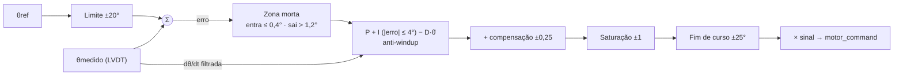

# SteeringController

> `include/control/SteeringController.h` · `src/control/SteeringController.cpp`

## Visão geral

Controle de **posição do esterçamento**: recebe o ângulo de referência (ROS) e o ângulo medido pelo LVDT e calcula o comando do motor de esterçamento. É um **PID** com o D sobre a velocidade medida, zona morta com histerese, integral só perto da referência (com anti-windup), compensação da zona morta do motor, saturação e proteção de fim de curso.

Diagramas detalhados (malha, fluxograma, característica estática e fragilidades): [`doc/arquitetura/controle_estercamento/`](../arquitetura/controle_estercamento/). São anteriores a 31/10: ainda mostram o piso de 0,15 e o D sobre o erro.

## Onde é usada

| Quem | Método | Frequência |
|---|---|---|
| `TaskControl` | `update(referência, snapshot do LVDT, permissão)` | 200 Hz |
| [SafetyManager](../safety/SafetyManager.md) | `getLastOutput()` (idade e validade da saída) | 200 Hz |

## Interface pública

| Método | Descrição |
|---|---|
| `update(reference, sensor, motion_permitted)` | Calcula a saída de um ciclo (ver abaixo) |
| `getLastOutput()` | Última saída e seu instante (`timestamp_us = 0` se inválida) |
| `reset()` | Zera integral, erro anterior e estado da zona morta |

### Output

| Campo | Descrição |
|---|---|
| `target_angle_deg` | Referência efetivamente usada (já limitada) |
| `measured_angle_deg` | Ângulo medido (NaN se o sensor estava inválido ou velho) |
| `angle_error_deg` | Referência − medido |
| `proportional_term`, `integral_term`, `derivative_term` | Parcelas do PID |
| `normalized_command` | Comando na convenção do ângulo `[-1, 1]` |
| `motor_command` | Mesmo comando na convenção do motor (`> 0` = PWM da direita) |
| `inside_deadband` | Dentro da zona morta (comando 0) |
| `saturated` | O PID passou de ±1 antes da saturação |
| `target_clamped` | Referência limitada à faixa de trabalho |
| `position_limit_active` | Proteção de fim de curso bloqueou o comando |
| `valid` | Saída utilizável |

## Funcionamento

Ordem das etapas em cada ciclo (`update()` → `compute()`):

1. **Idade do sensor:** leitura inválida ou com mais de `STEERING_SENSOR_SNAPSHOT_TIMEOUT_MS` (20 ms) vira `NaN`.
2. **dt:** tempo desde a chamada anterior (no primeiro ciclo, `TASK_CONTROL_PERIOD_MS`).
3. **Validação:** referência, medição ou dt não finitos, ou dt fora de `(0, 100 ms]` → `reset()` e **saída inválida**.
4. **Limite da referência:** `[STEERING_REFERENCE_MIN_DEG, STEERING_REFERENCE_MAX_DEG]` = ±20° (`target_clamped`).
   **Limite de taxa:** a referência usada caminha até a pedida a no máximo `STEERING_REFERENCE_MAX_RATE_DEG_S` (40°/s); sem permissão de movimento (ou após um reset) ela parte do ângulo medido. Degraus do analógico viram rampas (no chão, em 30/10, os degraus acumulavam integral e davam tranco).
5. **Erro** e **velocidade medida** para o D: derivada do ângulo medido, filtrada com `STEERING_DERIVATIVE_FILTER_TAU_S` (20 ms; zero no primeiro ciclo após um reset). O D é `−Kd·θ̇`, sobre a medição e não sobre o erro: freia a aproximação sem reagir aos degraus da referência. A velocidade do [SteeringSensor](../sensors/SteeringSensor.md) não serve aqui (~0,2 s de filtro).
6. **Zona morta com histerese:** fora dela, só entra com \|erro\| ≤ 0,4°; dentro dela, só sai com \|erro\| > 1,2°. Dentro: comando 0 e integral zerada.
7. **Integral** (só com movimento permitido, e com \|erro\| ≤ `STEERING_INTEGRAL_ZONE_DEG` = 4° **ou** a direção parada, \|θ̇\| < `STEERING_INTEGRAL_STALL_RATE_DEG_S` = 5°/s; aproximando rápido de longe fica em zero, para não passar da referência):
   - **cruzou a referência** (erro trocou de sinal): integral zerada, para não empurrar além dela;
   - integral candidata = `clamp(∫ + erro·dt, ±5 °·s)` (parcela integral até ±0,5);
   - **anti-windup condicional:** a candidata é rejeitada se o comando já passa de ±1 e ela aumentaria a saturação. Uma integral que ajuda a sair da saturação é aceita.
   - **sem permissão de movimento**, a integral fica em zero (o motor está parado; integrar acumularia erro e o esterçamento partiria saturado ao habilitar).
8. **Compensação da zona morta do motor:** `u ≠ 0` vira `sinal(u)·(0,25 + |u|)`. No chão a direção quase não se move abaixo de PWM ~75–80 (bags de 30/10); a compensação leva o comando para logo abaixo do arranque e o P completa o resto.
9. **Saturação** em `±MAX_ABS_STEER_COMMAND` (`saturated`).
10. **Fim de curso:** com o medido ≥ +25° e comando positivo (ou ≤ −25° e negativo), o comando vai a 0 e a integral é zerada. O comando no sentido de volta continua permitido.
11. **Saída:** `motor_command = STEERING_ANGLE_SIGN × normalized_command`, publicada com timestamp.

### Limites de ângulo

| Faixa | Valor | Quem aplica |
|---|---|---|
| Trabalho (referência) | ±20° | `SteeringController` (passo 4) |
| Segurança (fim de curso) | ±25° | `SteeringController` (passo 10) |
| Fundo de escala do LVDT | ~−28,5° / ~+34,5° | [SteeringSensor](../sensors/SteeringSensor.md) (invalida a leitura) |
| Fim físico do lado mais curto | ~28,9° | mecânica |

## Parâmetros (`config.h`)

| Parâmetro | Valor | Uso |
|---|---|---|
| `STEERING_DIRECT_KP` | 0,05 /° | Ganho proporcional |
| `STEERING_DIRECT_KI` | 0,1 /(°·s) | Ganho integral |
| `STEERING_DIRECT_KD` | 0,002 /(°/s) | Ganho derivativo, sobre a velocidade medida |
| `STEERING_DIRECT_INTEGRAL_MIN/MAX` | ±5 °·s | Limite da integral (±0,5 de comando) |
| `STEERING_INTEGRAL_ZONE_DEG` | 4° | Integral com \|erro\| até aqui… |
| `STEERING_INTEGRAL_STALL_RATE_DEG_S` | 5°/s | …ou com a direção parada (velocidade medida abaixo disto) |
| `STEERING_DERIVATIVE_FILTER_TAU_S` | 0,02 s | Filtro da velocidade medida (D) |
| `STEERING_DEADZONE_COMPENSATION` | 0,25 | Compensação da zona morta do motor (PWM 64) |
| `STEERING_REFERENCE_MAX_RATE_DEG_S` | 40°/s | Taxa máxima da referência |
| `STEERING_DEADBAND_ENTER_DEG` | 0,4° | Entrada na zona morta |
| `STEERING_DEADBAND_EXIT_DEG` | 1,2° | Saída da zona morta |
| `MAX_ABS_STEER_COMMAND` | 1,0 | Saturação |
| `STEERING_REFERENCE_MIN/MAX_DEG` | ±20° | Faixa de trabalho |
| `STEERING_MIN/MAX_DEG` | ±25° | Limite de segurança |
| `STEERING_CONTROL_MAX_DT_S` | 0,1 s | dt máximo antes de resetar |
| `STEERING_SENSOR_SNAPSHOT_TIMEOUT_MS` | 20 ms | Idade máxima da leitura do LVDT |

## Concorrência

O estado interno (integral, erro anterior, zona morta) só é usado pela `TaskControl`. A última saída é publicada sob `portMUX` e lida pelo `SafetyManager` via `getLastOutput()`.

## Pontos de atenção

- **Ganhos de 31/10, ainda não testados no chão.** Até 30/10 era Kp 0,007, Ki 0,1 e piso de 0,15 (PWM 38): na prática um relé de ±0,15 com o motor parado, esperando a integral subir até o arranque (~PWM 80). Daí os ~0,3 s de atraso e os 3–7° de sobressinal no 1º Stanley. Os ganhos novos saíram de uma simulação deste código com o motor medido nos bags de 30/10 (taxa × PWM, ~40 ms de atraso):

  | | Degrau de 10° | Seno de 8° a 0,7 Hz |
  |---|---|---|
  | Antes | 0,67 s, passa 5,3° | amplitude 14°, atraso 342 ms |
  | Agora | 0,30 s, passa 0,5° | amplitude 8°, atraso 92 ms |

  Com ±30% no ganho do motor, ±15 PWM no arranque ou atraso de 70 ms, o sobressinal fica em até ~3,5°.
- **Carga em curva fechada (31/10):** no 1º Stanley com estes ganhos, a integral só agia com \|erro\| ≤ 4°. Numa curva fechada à direita (raio de 2,3 m no caminho, Stanley saturado em −20°), a direção parou em −15,5° com 4,5° de erro e PWM ~120, sem integral para aumentar o esforço, e a plausibilidade deu flag 512 depois de 1 s. Em 30/10, com o controlador antigo, ela tinha chegado a −20,5° no mesmo trecho. Correção: integral também com a direção parada, e Ki de 0,05 para 0,1. Na simulação com uma carga de 70–90 PWM acima de 15,5°, a direção chega a −19,7° e fica travada no máximo 0,86 s. Conferir no chão com degraus; se oscilar, baixar `STEERING_DIRECT_KP` ou subir `KD`; se não chegar na referência com erro pequeno (atrito), subir `STEERING_DEADZONE_COMPENSATION`.
- **Plausibilidade de travamento:** `STEERING_PLAUSIBILITY_MIN_COMMAND` (0,3) precisa ficar acima da compensação (0,25), verificado por `static_assert`.
- **Integral zerada na zona morta:** o redutor não trava a posição. Se o veículo em movimento empurrar as rodas para fora da zona morta, o controlador corrige com pulsos curtos. Observar em teste.
- **Referência sem limite de taxa:** o campo `angular_velocity_deg_s` da referência é recebido mas ignorado; degraus de referência viram velocidade máxima do motor.
- **D sobre o erro, sem filtro:** se Kd for ativado, degraus de referência geram pico (derivative kick). Preferir derivar a medição.
