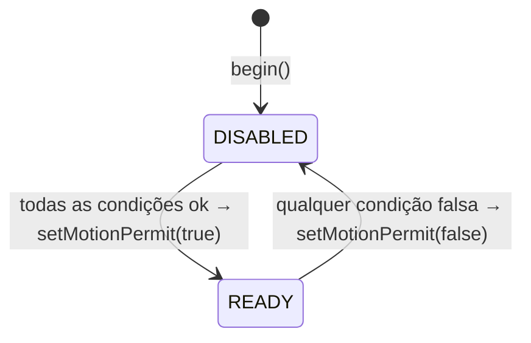
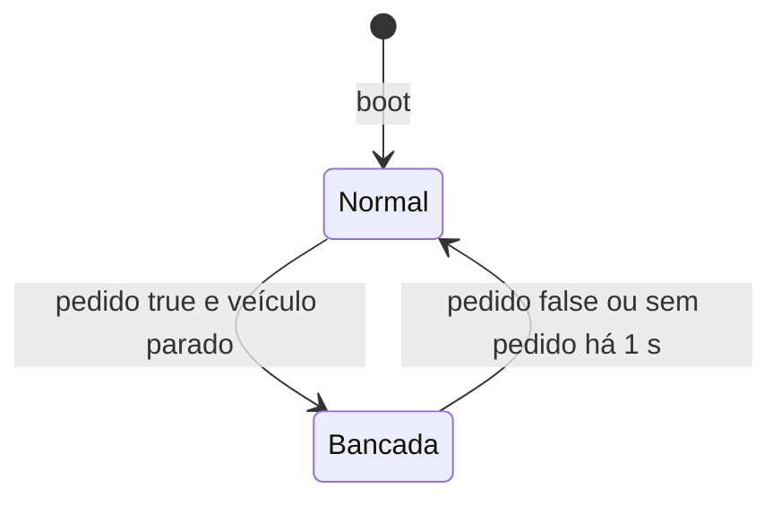

# SafetyManager

> `include/safety/SafetyManager.h` · `src/safety/SafetyManager.cpp`

## Visão geral

Decide, a cada ciclo, **se o veículo pode se mover**. O resultado vai para o [ActuatorManager](../actuators/ActuatorManager.md) via `setMotionPermit()`. Sem permissão, os motores param e o freio vai a total em rampa.

Também publica o **motivo** de cada bloqueio (`inhibit_flags`) em `/vida/safety/status`.

## Onde é usada

| Quem | Método | Frequência |
|---|---|---|
| `TaskSafety` | `update()` | 200 Hz |
| `TaskSensors` | `reportSensorTaskCycle()` | 500 Hz |
| [VidaRosNode](../comunication/VidaRosNode.md) | `getSnapshot()` | 50 Hz |

## Interface pública

| Método | Descrição |
|---|---|
| `SafetyManager(enable_pin, mailbox, actuator_manager, steering_controller)` | Dependências |
| `begin()` | Configura o pino de enable físico e parte em `STATE_DISABLED` e modo normal |
| `update(vehicle_stopped)` | Reavalia todas as condições, o modo bancada e aplica a transição de estado |
| `isBenchModeActive()` | Modo bancada efetivo |
| `reportSensorTaskCycle(lvdt, rear, right, left)` | Heartbeat da `TaskSensors`; só registra se todas as leituras forem válidas |
| `getSnapshot()` | Estado, condições e flags do último `update()` |

## Condições para permitir movimento

O estado é `STATE_READY` somente com **todas** as condições verdadeiras. Basta uma falsa para `STATE_DISABLED`.

| # | Condição | Limite | Flag quando falsa |
|---|---|---|---|
| 1 | Enable físico (GPIO 13) em nível alto | — | `INHIBIT_PHYSICAL_ENABLE_OFF` (1) |
| 2 | Enable lógico já recebido | — | `INHIBIT_LOGICAL_ENABLE_NOT_RECEIVED` (2) |
| 3 | Enable lógico = `true` | — | `INHIBIT_LOGICAL_ENABLE_FALSE` (4) |
| 4 | Enable lógico recente | 300 ms | `INHIBIT_LOGICAL_ENABLE_TIMEOUT` (8) |
| 5 | Referência de tração recente | 200 ms | `INHIBIT_DRIVE_REFERENCE_NOT_FRESH` (16) |
| 6 | Referência de esterçamento recente | 200 ms | `INHIBIT_STEERING_REFERENCE_NOT_FRESH` (32) |
| 7 | `TaskSensors` viva (heartbeat) | 20 ms (500 ms no boot) | `INHIBIT_SENSOR_TASK_TIMEOUT` (64) |
| 8 | Leitura do LVDT válida e recente | 20 ms | `INHIBIT_STEERING_SENSOR_NOT_FRESH` (128) |
| 9 | Saída do [SteeringController](../control/SteeringController.md) válida e recente | 20 ms | `INHIBIT_CONTROL_OUTPUT_TIMEOUT` (256)¹ |
| 10 | Encoders concordantes ([EncoderPlausibility](EncoderPlausibility.md)) — **falha retida**, desligada em modo bancada | 0,8 m/s por 0,5 s | `INHIBIT_ENCODERS_DISAGREE` (4096) |
| 11 | Esterçamento não travado ([SteeringPlausibility](SteeringPlausibility.md)) — **falha retida** | 1 s sem avançar 0,5° com \|cmd\| ≥ 0,3 | `INHIBIT_STEERING_STALLED` (512) |
| 12 | Esterçamento no sentido do comando ([SteeringPlausibility](SteeringPlausibility.md)) — **falha retida** | recuo de 2° após 0,2 s | `INHIBIT_STEERING_WRONG_DIRECTION` (1024) |
| 13 | Nenhuma task travada ([TaskSupervisor](TaskSupervisor.md)) — **retida até reiniciar** | 50 ms sem sinal de vida | `INHIBIT_TASK_SUPERVISOR_TRIP` (8192) |

¹ A flag 256 só é marcada quando as condições 1–6 estão ok, isto é, quando a saída do controlador é de fato necessária.

A idade das referências e do enable lógico é medida a partir do **instante de chegada no ESP32** (ver [CommandMailbox](../comunication/CommandMailbox.md)), não do timestamp da mensagem.

`setMotionPermit()` é chamado **só nas transições**. As condições 1–9 não são retidas: o estado volta a `READY` assim que elas voltam. As condições 10–12 ficam **retidas** até o rearme: enable físico desligado ou enable lógico `false`. A 13 fica retida até reiniciar o ESP32. O bit 2048 está reservado. A numeração é a mesma do `SafetyStatus.msg` do Odroid.

### Modo bancada

Permite testar o controle de velocidade com o veículo **suspenso**, onde só a roda traseira gira.

- **Pedido:** `/vida/safety/bench_mode_request` (`std_msgs/Bool`), publicado pelo gamepad: segurar **X por 5 s** para entrar e **O por 5 s** para sair.
- **Entrada:** só com o veículo parado (`update(vehicle_stopped)`, os 3 encoders). Pedido com o veículo em movimento fica pendente até ele parar.
- **Saída:** imediata. Sair é sempre seguro: se o veículo estiver suspenso, a condição 10 volta a valer e bloqueia.
- **Sempre inicia em modo normal**, e volta ao normal se o pedido deixar de chegar.
- **Modo efetivo** publicado em `/vida/safety/bench_mode`. O gamepad vibra ao receber a troca: contínua ao entrar, pulsada ao sair.

Na bancada:

| Item | Normal | Bancada |
|---|---|---|
| Velocidade realimentada ([VehicleMotion](../sensors/VehicleMotion.md)) | média das dianteiras | encoder traseiro |
| Condição 10 (encoders discordantes) | ativa | desligada |
| Velocidade máxima ([DriveController](../control/DriveController.md)) | 2,5 m/s | `BENCH_MODE_MAX_SPEED_M_S` = 4 m/s |

### Modo manobra

Freio solto para empurrar o veículo à mão, pedido pelo gamepad (R1 por 3 s) com `DriveReference.brake_command ≤ −0,5` (`MANEUVER_BRAKE_REQUEST`). Publicado em `/vida/safety/maneuver`. Funciona também com o enable físico desligado, com estas regras:

| Regra | Efeito |
|---|---|
| Entrada | só com o veículo parado (3 encoders) e o enable lógico `true` (gamepad vivo) |
| Enable físico desligado durante a manobra | cancela (emergência); para soltar de novo o pedido precisa ser desfeito e refeito |
| Velocidade > `MANEUVER_MAX_SPEED_M_S` (2,5 m/s) | cancela (veículo rolando sozinho) |
| Pedido sem referência recente (200 ms) ou enable lógico perdido | cancela |
| Supervisor de tasks disparado ou emergência retida | o [ActuatorManager](../actuators/ActuatorManager.md) ignora o pedido |

Durante a manobra o [ActuatorManager](../actuators/ActuatorManager.md) mantém o freio solto e a tração parada; o esterçamento só atua com movimento permitido. Ao sair, o freio volta a total imediatamente.

### Heartbeat da TaskSensors

`reportSensorTaskCycle()` guarda também as velocidades da roda traseira e da média das dianteiras, usadas pela condição 10. Ele atualiza o heartbeat quando os três encoders têm velocidade finita e uma medição já feita. Junto, guarda a validade e o instante da leitura do LVDT. Um LVDT inválido **não** interrompe o heartbeat: aparece só como flag 128, e a flag 64 fica reservada para a task parada ou encoders inválidos. A avaliação dos tempos é feita pelo [SafetyWatchdogs](SafetyWatchdogs.md).

## Snapshot

| Campo | Descrição |
|---|---|
| `state` | `STATE_DISABLED` (0) ou `STATE_READY` (1) |
| `physical_enable`, `logical_enable`, `logical_enable_received`, `logical_enable_fresh` | Condições 1–4 |
| `drive_reference_fresh`, `steering_reference_fresh` | Condições 5–6 |
| `sensor_task_healthy`, `steering_sensor_fresh`, `control_output_fresh` | Condições 7–9 |
| `encoders_disagree` | Condição 10 (falha retida) |
| `steering_stalled`, `steering_wrong_direction` | Condições 11 e 12 (falhas retidas) |
| `supervisor_tripped` | Condição 13 |
| `bench_mode_active` | Modo bancada efetivo |
| `motion_permitted` | Resultado |
| `inhibit_flags` | Soma dos motivos de bloqueio |
| `timestamp_us` | Instante do `update()` |

## Parâmetros (`config.h`)

| Parâmetro | Valor |
|---|---|
| `LOGICAL_ENABLE_WATCHDOG_TIMEOUT_MS` | 300 ms |
| `DRIVE_REFERENCE_WATCHDOG_TIMEOUT_MS` | 200 ms |
| `STEERING_REFERENCE_WATCHDOG_TIMEOUT_MS` | 200 ms |
| `SENSOR_TASK_WATCHDOG_TIMEOUT_MS` | 20 ms |
| `SENSOR_TASK_STARTUP_GRACE_MS` | 500 ms |
| `STEERING_SENSOR_SNAPSHOT_TIMEOUT_MS` | 20 ms |
| `CONTROL_OUTPUT_WATCHDOG_TIMEOUT_MS` | 20 ms |

## Concorrência

O heartbeat (escrito pela `TaskSensors`) e o snapshot (escrito pela `TaskSafety`) têm cada um o seu `portMUX`.

## Pontos de atenção

- O `SafetyStatus.msg` publica as flags, mas não os campos `sensor_task_healthy`, `steering_sensor_fresh` e `control_output_fresh`.
