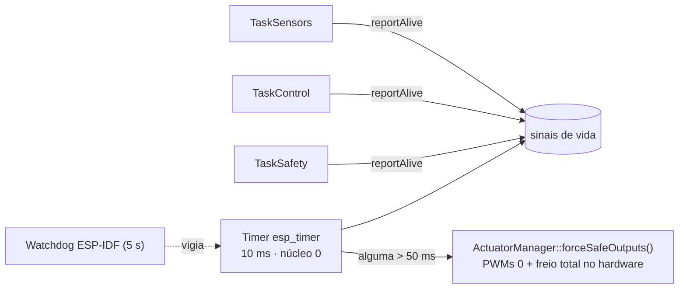

# TaskSupervisor

> `include/safety/TaskSupervisor.h` · `src/safety/TaskSupervisor.cpp`

## Visão geral

Vigia as tasks de tempo real do **núcleo 1** (`TaskSensors`, `TaskControl` e `TaskSafety`). Se uma delas travar, **corta os atuadores direto no hardware**.

### Por que existe

O watchdog de tarefas do ESP-IDF, como configurado pelo framework Arduino, só vigia a idle task do **núcleo 0**, com 5 s. As tasks do núcleo 1 não eram vigiadas. O periférico LEDC mantém o último PWM sozinho, então:

| Task travada | Sem o supervisor |
|---|---|
| `TaskControl` | O `SafetyManager` detecta a saída do controlador velha (20 ms) e para os motores |
| `TaskSensors` | O `SafetyManager` detecta o heartbeat velho (20 ms) e para os motores |
| **`TaskSafety`** ou mutex do `ActuatorManager` preso | **Nada reage**: os motores seguem no último PWM |

## Funcionamento

1. Cada task chama `reportAlive()` a cada ciclo.
2. Um timer do `esp_timer` (10 ms) roda no **núcleo 0**, fora das tasks vigiadas.
3. Uma task sem sinal de vida por **50 ms** (após 500 ms de tolerância no boot) dispara `ActuatorManager::forceSafeOutputs()`:
   - **PWM de tração e de esterçamento em 0** e **freio total**, escritos direto no hardware, **sem o mutex** (a task travada pode estar segurando);
   - a partir daí `applyCommands()` e `updateBrake()`, se ainda rodarem, mantêm o mesmo estado, e `setMotionPermit()` não libera;
   - o supervisor reescreve a saída segura a cada 10 ms.
4. A falha fica **retida até reiniciar o ESP32**. O `SafetyManager` marca `INHIBIT_TASK_SUPERVISOR_TRIP` (8192).

### Por que não reinicia sozinho

No reboot, o servo fica sem pulsos e **o freio solta**, e as entradas da ponte H e do driver ficam sem sinal até o `setup()`. Se a task travou com o veículo em movimento, ficar parado com freio total é mais seguro do que reiniciar.

### Falha dupla

O próprio supervisor é vigiado pelo **watchdog de tarefas do ESP-IDF**: o callback inscreve a task do `esp_timer` e o alimenta a cada ciclo. Se o supervisor parar, o ESP32 reinicia após `TASK_WDT_TIMEOUT_S` (5 s, o padrão do framework). O valor não foi reduzido porque esse watchdog também vigia o núcleo 0, onde o transporte serial do micro-ROS pode ocupar a CPU por ~1 s, e um disparo falso reinicia o ESP32 com o freio solto.

## Interface

| Método | Descrição |
|---|---|
| `TaskSupervisor(actuator_manager)` | Atuadores que serão forçados à saída segura |
| `begin()` | Configura o watchdog do ESP-IDF e inicia o timer (depois de criar as tasks) |
| `reportAlive(task)` | Sinal de vida: `Task::SENSORS`, `Task::CONTROL` ou `Task::SAFETY` |
| `isTripped()`, `trippedTask()` | Estado e task que disparou |

## Parâmetros (`config.h`)

| Parâmetro | Valor |
|---|---|
| `TASK_SUPERVISOR_PERIOD_MS` | 10 ms |
| `TASK_SUPERVISOR_TIMEOUT_MS` | 50 ms |
| `TASK_SUPERVISOR_STARTUP_GRACE_MS` | 500 ms |
| `TASK_WDT_TIMEOUT_S` | 5 s |

## Pontos de atenção

- **Hardware:** depois de um reset, nada no firmware segura o freio nem as entradas dos drivers. Conferir pull-downs nas entradas da ponte H e do driver de tração.
- Se a `TaskSafety` travar, o `/vida/safety/status` para de ser atualizado (o timestamp congela), mas a flag 8192 só aparece se ela voltar. Um status com timestamp parado é sinal de task travada.
