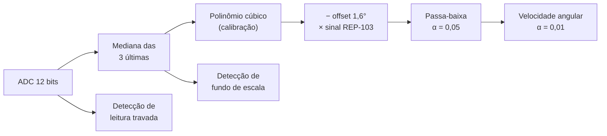

# SteeringSensor

> `include/sensors/SteeringSensor.h` · `src/sensors/SteeringSensor.cpp`

## Visão geral

Leitura do **LVDT** que mede o ângulo de esterçamento das rodas dianteiras, ligado ao ADC1 do ESP32 (GPIO 36). Converte a leitura do ADC no ângulo da **roda virtual do modelo de bicicleta**, filtra o sinal, estima a velocidade angular e **valida a leitura** (desconexão, curto, fim de escala e sinal travado).

## Onde é usada

| Quem | Método | Frequência |
|---|---|---|
| `TaskSensors` | `update()` | 500 Hz |
| [SteeringController](../control/SteeringController.md) (via `TaskControl`) | `getSnapshot()` | 200 Hz |
| [SafetyManager](../safety/SafetyManager.md) (heartbeat) | `getSnapshot()` | 500 Hz |
| [VidaRosNode](../comunication/VidaRosNode.md) → `/vida/sensors/steering` | `getSnapshot()` | 50 Hz |

## Interface pública

| Método | Descrição |
|---|---|
| `SteeringSensor(adc_pin)` | Guarda o pino |
| `begin()` | Configura o ADC (12 bits) e o pino |
| `update()` | Lê o ADC e atualiza ângulo, velocidade angular e validade |
| `getSnapshot()` | Cópia coerente da última leitura |
| `adcToAngleDeg(adc)` (estático) | Converte ADC em ângulo (polinômio, offset e sinal) |
| `getRawAdc()`, `getRawAngleDeg()`, `getFilteredAngleDeg()`, `getAngularVelocity()` | Valores individuais (sem proteção de concorrência) |

### Snapshot

| Campo | Unidade | Descrição |
|---|---|---|
| `timestamp_us` | µs | Instante da leitura **válida**; `0` se a leitura é inválida (usado pelo controle e pela segurança) |
| `sample_timestamp_us` | µs | Instante da leitura, válida ou não (usado na telemetria) |
| `raw_adc` | counts | Leitura bruta do ADC, **antes** da mediana |
| `raw_angle_deg` | ° | Ângulo da mediana, sem filtro |
| `filtered_angle_deg` | ° | Ângulo filtrado (é o que o controlador usa) |
| `filtered_angular_velocity_deg_s` | °/s | Derivada do ângulo filtrado, filtrada |
| `adc_rail_fault` | — | ADC no fundo/fim de escala |
| `adc_stuck_fault` | — | ADC sem variação (sinal perdido) |
| `valid` | — | Leitura utilizável |

## Funcionamento



### Conversão ADC → ângulo

Com `d = adc − STEERING_ADC_CENTER`, na convenção dos dados de calibração (direita positivo):

```
δ_calibração = A·d + B·d² + C·d³ − STEERING_ZERO_OFFSET_DEG
δ = STEERING_ANGLE_SIGN × δ_calibração          (REP-103: esquerda positivo)
```

A curva é **assimétrica**. Pontos de referência do polinômio atual:

| ADC | Ângulo (REP-103) |
|---|---|
| 0 | −28,9° (fim físico do lado direito) |
| 796 | −22° |
| 1971 | 0° |
| 3048 | +22° |
| 4095 | +34,7° |

Sensibilidade no centro: ~0,0215 °/count.

### Filtros

- **Mediana de 3** sobre o ADC: remove glitches isolados. No teste de 12/10/2026 houve uma leitura de 4095 entre leituras de ~2770.
- **Passa-baixa** do ângulo: `α = 0,05` a 500 Hz, τ ≈ 39 ms (corte ≈ 4 Hz). Esse atraso fica dentro da malha de controle.
- **Velocidade angular:** diferença do ângulo filtrado, filtrada com `α = 0,01` (só telemetria).

### Validação da leitura

| Falha | Condição | Causa provável |
|---|---|---|
| Fundo/fim de escala | ADC (após a mediana) fora de `[40, 4055]` por ≥ 10 ms | Sensor desconectado com entrada puxada a 0/3,3 V, curto, ou esterçamento além do curso do sensor |
| Leitura travada | ADC bruto dentro de ±3 counts por ≥ 500 ms | Sinal perdido |

A leitura travada funciona porque o LVDT **sempre oscila**: parado, o desvio-padrão é de ~25 counts, e no teste a maior permanência dentro de ±3 counts foi de 100 ms. Com qualquer falha, `valid = false` e `timestamp_us = 0`. O [SteeringController](../control/SteeringController.md) recebe medição inválida, a saída fica inválida e o [SafetyManager](../safety/SafetyManager.md) bloqueia o movimento. A falha não fica retida: some quando a condição desaparece.

## Parâmetros (`config.h`)

| Parâmetro | Valor | Uso |
|---|---|---|
| `ADC_RESOLUTION_BITS` | 12 | Resolução do ADC |
| `STEERING_ADC_CENTER` | 2046 | Centro do polinômio |
| `STEERING_POLY_A/B/C` | −2,14862e-2 / −3,09559e-7 / 1,42370e-9 | Coeficientes da calibração |
| `STEERING_ZERO_OFFSET_DEG` | 1,6° | Offset de zero (teste de 12/10/2026) |
| `STEERING_INVERT_SIGN` | 1 | Convenção REP-103 |
| `STEERING_FILTER_ALPHA` | 0,05 | Filtro do ângulo |
| `STEERING_VELOCITY_FILTER_ALPHA` | 0,01 | Filtro da velocidade angular |
| `STEERING_ADC_VALID_MIN/MAX` | 40 / 4055 | Faixa válida do ADC |
| `STEERING_ADC_RAIL_TIME_MS` | 10 ms | Persistência para fundo de escala |
| `STEERING_ADC_STUCK_TOLERANCE` | 3 counts | Faixa de "leitura travada" |
| `STEERING_ADC_STUCK_TIME_MS` | 500 ms | Tempo para "leitura travada" |

## Concorrência

`update()` escreve todos os campos dentro de um `portMUX`; `getSnapshot()` lê dentro do mesmo `portMUX`. Os estados internos (filtro, mediana, detectores) só são usados pela `TaskSensors`.

## Pontos de atenção

- **Entrada flutuante não é detectada:** se o fio soltar e a entrada ficar flutuando, o ADC lê ruído, nem travado nem no extremo. Esse caso fica para a plausibilidade comando × movimento (TODO).
- Os limites da detecção de leitura travada dependem do ruído atual do sensor. Se o ruído for reduzido no hardware, revisar `STEERING_ADC_STUCK_*`.
- O ganho do sensor ainda não foi validado: a análise de 12/10/2026 indica que o veículo curva ~20% menos do que o ângulo medido sugere (pode ser o sensor ou o entre-eixos).
